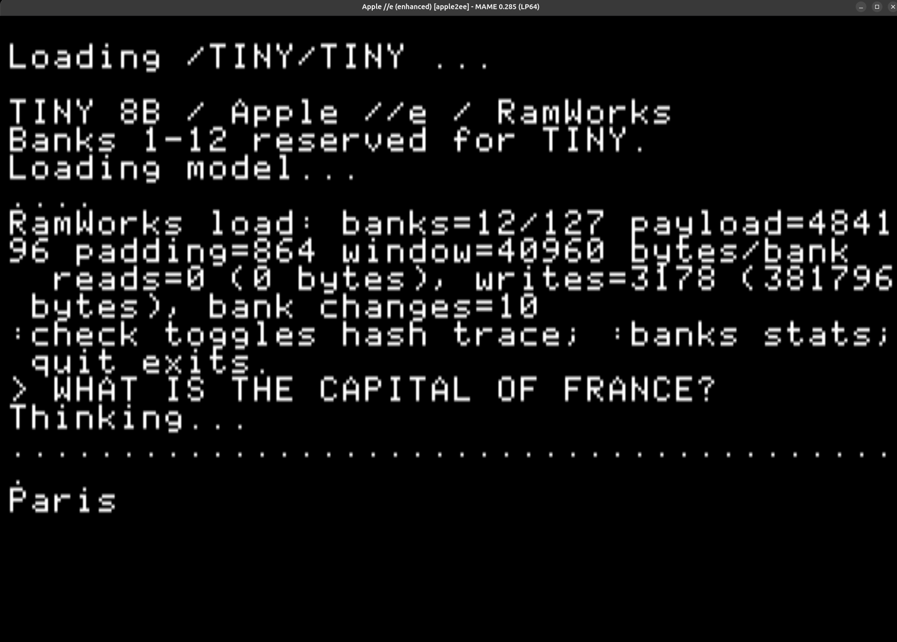

# TINY for the Apple //e

**A 367,000-parameter transformer running natively on a 65C02 under ProDOS.**

This is an Apple II port of [TINY 2.1](https://github.com/WollyMonjac/Tiny-2.1), a small character-level question-answering language model originally written for DOS. The port runs the original trained network on an enhanced Apple //e with RamWorks-compatible auxiliary memory, using entirely integer arithmetic and native 65C02 assembly for its most computationally intensive operations.

There is no Raspberry Pi, modern accelerator card doing the neural-network computation, remote inference server, or cloud API involved. The 65C02 does the mathematics itself. Training and model conversion take place on a modern computer; inference takes place on the Apple II.

This is very much an experiment in what old hardware can do, rather than an attempt to build a useful contemporary AI assistant. As with a dog that can sing, the remarkable thing is not how well it sings, but that it sings at all.

## It works!

On **25 November 2026**, the first successful end-to-end test in MAME's enhanced Apple //e emulation produced the following result:

```text
TINY 8B / Apple //e / RamWorks
Banks 1-12 reserved for TINY.
Loading model...
....

> WHAT IS THE CAPITAL OF FRANCE?
Thinking...
........................................
.
Paris
```



The answer took rather a long time to arrive, but Paris was still the capital of France when it did.

## The original model

TINY 2.1 was designed to run on 486DX- and Pentium-class DOS machines. It is a small autoregressive transformer trained to answer questions drawn from approximately 3,500 facts, presented in various forms. Unlike most modern language models, it reads and generates text one character at a time.

The Apple II port retains the original architecture, context window and trained 8-bit matrix weights. No retraining, pruning, or reduction in the number of layers was necessary.

| Model characteristic | Value |
| --- | ---: |
| Architecture | Decoder-only causal transformer |
| Trainable parameters | 366,528 |
| Transformer blocks | 4 |
| Embedding width | 96 |
| Attention heads per block | 4 |
| Dimensions per attention head | 24 |
| Feed-forward hidden width | 256 |
| Vocabulary | 97 tokens |
| Context window | 128 tokens |
| Matrix weights | Signed 8-bit integers |
| Position encoding | Learned positional embeddings |
| Normalization | RMS normalization |
| Feed-forward activation | ReLU |
| Output projection | Shared with token embedding matrix |

The 128-token context is shared between the question and its generated answer. The current frontend accepts up to 72 printable input characters. This is a deliberately tiny model with a limited body of knowledge, not a general-purpose conversational LLM. It can and does produce incorrect answers.

## What changed from TINY 2.1?

The original DOS implementation already stores its matrix weights and attention cache in quantized form, but carries out much of the inference arithmetic in floating point. Simply recompiling that implementation for a 65C02 would be impractical. The Apple II has no hardware multiplier, floating-point unit, or flat address space large enough for the model.

The port therefore reimplements the inference engine around the capabilities of an eight-bit processor.

| Component | Original TINY 2.1 | Apple II port |
| --- | --- | --- |
| Target | x86 / DOS | 65C02 / ProDOS |
| Development tools | Turbo C | GCC for reference builds; cc65 and ca65 for Apple II |
| Matrix weights | INT8 with floating-point row scales | Original INT8 bytes with integer row scales |
| Activations and residuals | Floating point | 16-bit block fixed point |
| Matrix and attention MACs | Floating-point arithmetic | Signed byte arithmetic with 24-bit assembly accumulators |
| RMS normalization | Floating point | Integer square root and reciprocal scaling |
| Softmax | Floating-point exponential | Fixed-point exponential lookup table |
| Wide intermediate arithmetic | Native arithmetic | Software arithmetic using pairs of 32-bit words |
| Model and KV cache storage | DOS conventional memory | Banked RamWorks auxiliary memory |
| Model file | `TINY.BIN` (`TNY2`) | `TINY.INT` (`TNI6`) |
| User interface | DOS full-screen display and PC speaker | Simple ProDOS text console |

The model converter retains the original weight bytes and converts the floating-point scale factors and normalization gains to integer representations. Activation quantization and fixed-point arithmetic introduce numerical approximations, so the results are not guaranteed to be identical to the original DOS implementation for every prompt.

### Integer arithmetic

Vectors are represented by signed 16-bit mantissas and a common binary exponent:

```text
x[i] = mantissa[i] * 2^exponent
```

This block fixed-point representation provides useful dynamic range without a floating-point operation for every individual activation. Matrix operations temporarily quantize activations to signed bytes, accumulate the products, then rescale the result to the block fixed-point representation. Residual connections align exponents before adding vectors.

The runtime contains no floating-point data types or native 64-bit integer types, and does not require `libm`. Operations needing wider intermediate precision use explicit multiword arithmetic. RMS normalization uses an integer square root; softmax uses an offline-generated lookup table covering the relevant negative-exponential range.

### 65C02 multiplication and accumulation

The 6502 family has no multiply instruction, so the native MAC kernels use the classic quarter-square identity:

```text
a * b = floor((a + b)^2 / 4) - floor((a - b)^2 / 4)
```

Both squared terms have the same parity, so truncating their fractional parts introduces no error. Two byte-plane lookup tables occupy just 1 KiB and implement exact signed 8-bit multiplication using table accesses and subtraction.

The assembly module implements complete dot-product and scaled-vector accumulation loops, avoiding the overhead of calling an assembly multiply routine for every pair of operands. Products accumulate into signed 24-bit sums, exposed to the C engine as sign-extended 32-bit results. Longer dot products are split where necessary to avoid overflow.

These kernels handle the projections, feed-forward layers, query-key attention and weighted value accumulation. The rest of the engine is currently integer C, compiled by cc65.

### RamWorks memory management

The Apple II's 16-bit address space is much smaller than the model. Rather than treating auxiliary memory as a flat address space, TINY stores data in fixed-size records with explicit bank and offset addressing. Records never straddle bank boundaries.

The current implementation uses banks 1 through 12, reserving bank 0 for the usual Apple II auxiliary-memory environment. Only addresses `$2000` through `$BFFF` are used in each expansion bank, providing a 40 KiB data window per bank.

| Auxiliary memory allocation | Bytes |
| --- | ---: |
| Model weights, scales and gains | 381,796 |
| Key cache (including scale metadata) | 51,200 |
| Value cache (including scale metadata) | 51,200 |
| Bank-boundary padding | 864 |
| **Total allocated** | **485,060** |

The inference engine, working vectors, staging buffers, lookup tables and C stack reside in main memory. Matrix rows and relevant attention-cache segments are copied to a main-memory buffer for computation.

Native memory transfers use the Apple //e firmware's `AUXMOVE` routine at `$C311`, with RamWorks bank selection at `$C073`. The assembly wrapper preserves the firmware's temporary zero-page workspace, masks interrupts during transfers, and restores main-memory access and auxiliary bank 0 before returning to C. The MAC routines borrow cc65's existing scratch pointers rather than allocating additional zero-page storage.

## Development history

The port was developed incrementally, using Linux as a reference platform before moving to the Apple II. Each stage was tested against its predecessor, with deterministic generation, test questions and, where appropriate, logit comparisons.

| Stage | Work undertaken |
| --- | --- |
| 0 | Establish a floating-point Linux reference implementation. |
| 1 | Replace matrix-vector multiplication with integer MACs. |
| 2 | Convert query-key dot products and weighted value accumulation to integers. |
| 3 | Introduce block fixed-point activation and residual vectors. |
| 4 | Implement integer RMS normalization. |
| 5 | Implement lookup-table softmax and integer token sampling. |
| 6 | Remove all remaining floating point; introduce the offline `TINY.INT` converter. |
| 7A | Replace native 64-bit arithmetic with explicit multiword integer routines and audit 16-bit C portability. |
| 7B | Implement exact quarter-square multiplication. |
| 7C | Implement native 65C02 MAC kernels and test them with `sim65`. |
| 8A | Simulate RamWorks banked storage under Linux. |
| 8B | Implement native RamWorks transfers and the ProDOS console application; resolve cc65 linker and memory-layout issues. |

This approach made it possible to distinguish arithmetic errors from compiler, assembly and bank-switching errors. It also leaves a portable reference implementation for future optimization work.

## Building and running

### Requirements

- Enhanced Apple //e with a 65C02, or a compatible emulator such as MAME (`apple2ee`).
- RamWorks-compatible expansion providing at least 13 distinct 64 KiB auxiliary banks (bank 0 plus banks 1–12). A 1 MiB or larger card provides sufficient capacity.
- ProDOS 8 and a volume with enough free space for the program, loader and approximately 373 KiB model file.
- A modern build host with Python 3 and a consistent installation of the [cc65 toolchain](https://cc65.github.io/).
- A means of transferring ProDOS files, such as [Cadius](https://github.com/mach-kernel/cadius).

**Warning:** TINY reserves and overwrites data in auxiliary banks 1–12. Do not run it while a RamWorks RAM disk or other application is using these banks. Save your work first. A startup probe checks for aliased or missing banks.

### 1. Convert the model

Obtain the released `dos/TINY.BIN` from the [original TINY 2.1 repository](https://github.com/WollyMonjac/Tiny-2.1). Run the supplied converter on the build host:

```sh
python3 tiny-convert.py TINY.BIN TINY.INT
```

The conversion is a one-time operation. Python and the original training software are not required on the Apple II.

### 2. Build the Apple II executable

In the directory containing the Apple II source files, use the C source (`tiny.c`) and the zero-page-compatible assembly kernel (`tiny-mac65-zp.s`):

```sh
cl65 -t apple2enh -O \
    --ld-args '-D__EXEHDR__=0,-D__HIMEM__=0xBF00' \
    -m tiny.map -o TINY \
    tiny.c tiny-rw65.c tiny-rw65-asm.s tiny-mac65-zp.s
```

This builds a raw BIN executable linked at `$0803`. Loading at `$0803` rather than the standard SYS address of `$2000` makes approximately 6 KiB more main memory available to the application. The `__HIMEM__` override is important, and linker options passed through `--ld-args` must be comma-separated.

A matching set of compiler, assembler, linker and libraries is required. The successful development build used Ubuntu's packaged cc65 tools (`/usr/bin/cl65`), rather than a separate older installation in the shell's search path.

Locate the supplied cc65 ProDOS loader (the path varies by installation):

```sh
find /usr/share/cc65 -iname loader.system
```

### 3. Install on a ProDOS volume

Place the following three files in the same ProDOS directory:

| File | ProDOS type | Auxiliary type |
| --- | --- | --- |
| `TINY.SYSTEM` (renamed copy of cc65 `loader.system`) | SYS (`$FF`) | `$0000` |
| `TINY` | BIN (`$06`) | `$0803` |
| `TINY.INT` | BIN (`$06`) | `$0000` |

With Cadius, file types and auxiliary types can be encoded in the host filenames. For example, after substituting the actual path to `loader.system`:

```sh
cp TINY 'TINY#060803'
cp /path/to/loader.system 'TINY.SYSTEM#FF0000'
cp TINY.INT 'TINY.INT#060000'
```

For a ProDOS disk image named `tiny.po` with volume name `TINY`:

```sh
cadius ADDFILE tiny.po /TINY/ 'TINY#060803'
cadius ADDFILE tiny.po /TINY/ 'TINY.SYSTEM#FF0000'
cadius ADDFILE tiny.po /TINY/ 'TINY.INT#060000'
```

Cadius removes the suffixes and sets the corresponding ProDOS metadata.

### 4. Run

Set the ProDOS prefix to the directory containing the three files. From BASIC.SYSTEM, launch:

```text
-TINY.SYSTEM
```

The loader starts the program, which probes auxiliary memory and loads `TINY.INT`. At the `>` prompt, enter a question. A progress dot is printed after processing each input token, including the prompt terminator. Answer characters are displayed as they are generated.

| Command | Function |
| --- | --- |
| `:c0` | Deterministic generation (default) |
| `:c1` … `:c9` | Select nonzero creativity for probabilistic sampling |
| `:check` | Toggle per-token logit checksum diagnostics |
| `:banks` | Display bank allocation and memory-transfer statistics |
| `quit` or `exit` | Return to ProDOS |

In MAME, enable a RamWorks-compatible expansion and attach your ProDOS boot and model volumes. Turning off throttling (normally F10 in MAME's UI keyboard mode) speeds up inference, but also makes keyboard repeat rather enthusiastic. Re-enable throttling while entering questions, and disable it again during inference.

## Testing on Linux

The same source can be built as a standalone Linux application, with the RamWorks memory backend simulated and the portable C MAC kernels selected automatically:

```sh
gcc -std=c99 -O2 -Wall -Wextra -DTINY_SMALL \
    tiny.c -o tiny-linux

./tiny-linux -q 'what is the capital of france?'
./tiny-linux --profile --banks -q 'what is the capital of france?'
```

`--logits` emits a CSV of next-token scores for each input position; `--check` emits compact checksums useful for cross-platform regression testing.

```sh
./tiny-linux -q 'abc' --check
```

On the Apple II, enter `:check`, then `abc`, and compare the printed position, input token, shared binary exponent and FNV-1a hash with the Linux output. This checks the raw fixed-point logit mantissas without requiring a large diagnostic dump from the Apple II.

The Stage 7C assembly test harness can also be run independently of the transformer:

```sh
cl65 -t sim65c02 -O -o mac65-test tiny-mac65-test.c tiny-mac65-zp.s
sim65 mac65-test full
sim65 -c mac65-test bench
```

The original Stage 7C assembly passed the exhaustive signed-byte multiplication test and the dot-product and weighted-accumulation tests in `sim65`. The benchmark produced the expected checksum of `41417000` for 256,000 MACs.

## Performance (or lack thereof)

A forward pass through the original model requires up to 353,376 dense matrix multiply-accumulates, plus attention work that grows with the number of tokens in context. At a full context of 128 tokens, the theoretical total reaches 451,680 MACs per token (before skipping zero-valued attention coefficients).

Since each output token represents one character, this is a considerable amount of arithmetic just to print one letter. The entire question must also be processed character by character before the answer begins. Memory transfers, normalization and multiword scaling add further overhead.

This is not a fast implementation. It is a *working* implementation. A quantified tokens-per-second benchmark on physical hardware remains to be done.

Possible future work:

- Profile and optimize the native MAC kernels and software multiword arithmetic.
- Reduce bank-transfer overhead by staging groups of matrix rows, or by developing bank-aware computation kernels.
- Optimize fixed-point scaling, division and normalization for the 65C02.
- Investigate the effects of hardware acceleration, including the UltraWarp II, and its interaction with unaccelerated expansion RAM.
- Explore smaller or ternary-weight models specifically trained for eight-bit inference.

## Status

The original trained model has been successfully exercised through the intermediate Linux implementations, the Stage 7C arithmetic kernels have passed tests in `sim65`, and native ProDOS inference has produced a correct answer in MAME. The screenshot above documents that milestone. Comprehensive Apple II regression tests, measured performance and verification on physical hardware remain future work.

## Acknowledgements and licensing

- **[WollyMonjac and TINY 2.1](https://github.com/WollyMonjac/Tiny-2.1)** — the original DOS project, model architecture, training pipeline, training data and pretrained model. This project would not exist without that work. The upstream README also credits Anthropic's Fable 5.2 for writing the original implementation and Opus 5.5 for training the model.
- **Bobbi (bobbimanners)** — initiated the Apple II port, directed its design, compiled and tested each stage, debugged the native build and brought up the first working ProDOS implementation in MAME.
- **ChatGPT (OpenAI)** — AI development collaborator on the Apple II port. ChatGPT helped design the staged conversion, wrote and revised the C and 65C02 assembly implementations, developed the model converter and regression test tools, and assisted with cc65 and memory-layout debugging. The original model was not trained by ChatGPT; its contribution was to the inference-engine port.
- The developers and maintainers of **cc65, MAME, Cadius and ProDOS**, and the Apple II community, whose tools and accumulated knowledge make projects like this possible.

The original TINY 2.1 source code is MIT-licensed. Retain the upstream copyright and license notices when redistributing derived code. Consult the upstream `LICENSE` and `DATA_LICENSES.md` for the applicable terms, particularly for the model's training data and derived assets. This README does not establish a separate license for the Apple II port.

---

*The dog can sing. And it was even in tune.*
